  

  
  

 

### `$ whoami`

Networks & Telecom student at **IUT Nancy-Brabois** (BUT R&T, 2nd year).
Previously **BUT Computer Science** at IUT Nice, as an apprentice application developer.
Heading to **engineering school**. Daily driver: **Arch Linux**.

### `$ ls ~/stack`

  

### `$ ls ~/projects`

| Project | What it is | Status |
|:--|:--|:--|
| **restaurant-site** | Showcase website for a fine-dining restaurant | `wip` |
| **notes-ai** | Notes app with a local LLM generating spaced-repetition questions | `planned` |
| **homelab** | Wake-on-LAN, remote access, self-hosted services | `planned` |

### `$ cat ~/.interests`

Networking · Self-hosting · Local AI · Optimization · Chess
