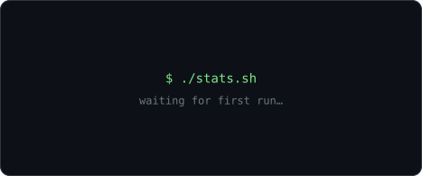

  

<!-- 

  

  
  
  
  
  

 

  
  

  

<picture>
  <source media="(prefers-color-scheme: dark)" srcset="profile/snake-dark.svg" />
  <source media="(prefers-color-scheme: light)" srcset="profile/snake.svg" />
  
</picture> -->
