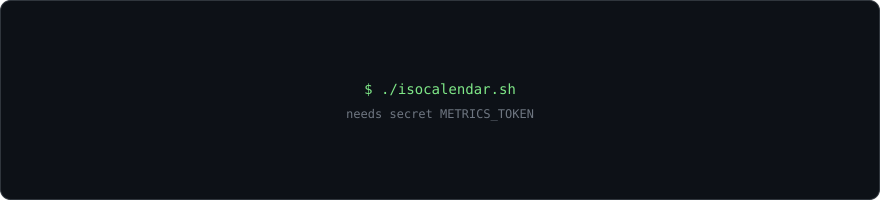

<p align="center">
  
</p>

<p align="center">
  <a href="https://www.linkedin.com/in/TON-PROFIL"></a>
  <a href="mailto:TON-EMAIL"></a>
  
  
</p>

<br />

```console
┌──(zeid㉿archi)-[~]
└─$ nmap -sV --top-ports 8 zeid

Starting Nmap 7.95 ( https://nmap.org )
Nmap scan report for zeid (10.0.0.42)
Host is up (0.0011s latency).

PORT       STATE      SERVICE     VERSION
22/tcp     open       ssh         Arch Linux daily driver · Bash · Git
53/udp     open       domain      DNS · DHCP · IPv4/IPv6 addressing & subnetting
179/tcp    filtered   bgp         routing & switching — OSPF, BGP, VLANs
443/tcp    open       https       HTML · CSS · JavaScript — client website
5060/udp   open       sip         VoIP / ToIP — telephony over IP
8080/tcp   open       http-alt    Flutter · Dart — ex-apprentice app developer
11434/tcp  filtered   ollama      local LLMs, self-hosted on my own GPU
51820/udp  filtered   wireguard   VPN · homelab · remote access

# open = in use   ·   filtered = currently learning / building
Nmap done: 1 IP address (1 host up) scanned in 0.42 seconds
```

### `$ cat /etc/profile`

- **Now** — BUT Networks & Telecom (R&T), IUT Nancy-Brabois — 2nd year, *Réseaux Opérateurs & Multimédia* track
- **Before** — BUT Computer Science, IUT Nice — apprentice **application developer**
- **Next** — engineering school, networks & security

### `$ which --all tools`

<p>
  
</p>
<p>
  
  
  
  
  
</p>

### `$ ls -l ~/projects`

| Project | What it does | Status |
|:--|:--|:--|
| **homelab** | Wake-on-LAN from my phone, WireGuard tunnel, self-hosted services, remote camera | `building` |
| **notes-ai** | Notes app (Flutter) — a local LLM turns notes into spaced-repetition quizzes | `planned` |
| **restaurant-site** | Showcase website for a fine-dining restaurant in Nancy | `wip` |

### `$ ./telemetry --live`

<p align="center">
  
  
</p>
<p align="center">
  
</p>
<p align="center">
  
</p>

<picture>
  <source media="(prefers-color-scheme: dark)" srcset="profile/snake-dark.svg" />
  <source media="(prefers-color-scheme: light)" srcset="profile/snake.svg" />
  
</picture>

<!--
  TryHackMe / Root-Me : quand tu as un compte, décommente et remplace TON-PSEUDO
  <p align="center">
    <a href="https://tryhackme.com/p/TON-PSEUDO"></a>
  </p>
-->

<p align="center">
  <sub><code>cards regenerated every 24 h by GitHub Actions · no third-party server at view time</code></sub>
</p>
